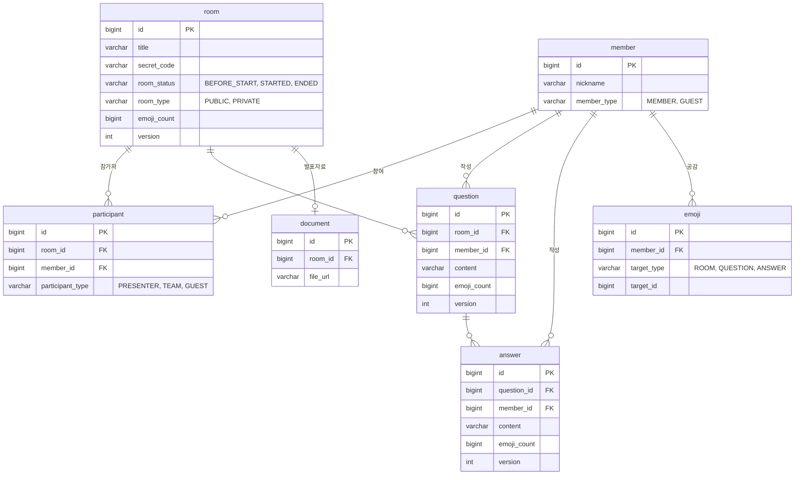

<div align="center">

# 🙋 Joinin

**발표 중에 청중과 발표자가 실시간으로 질문 · 답변 · 공감을 주고받는 Q&A 서비스**

프로그래머스 백엔드 데브코스 5기 최종 프로젝트 · 팀 OronaminC

<br>


[프론트엔드 저장소](https://github.com/prgrms-web-devcourse-final-project/WEB5_7_OronaminC_FE)

</div>

<br>

## 📌 한눈에 보기

| 📡 실시간 전달률 | ✍️ 답변 수정 성공률 | 🔒 WebSocket 보안 | 🧪 테스트 |
|:---:|:---:|:---:|:---:|
| **0% → 100%** | **62.8~74.8% → 99.7~100%** | **구멍 3종 차단** | **116개 통과** |
| 수정 · 삭제 브로드캐스트<br>(k6, 72,000건 기준) | 공감이 몰리는 답변 수정<br>(k6, 공감 VU 30~100) | 명의 위조 · 남의 방 구독<br>· 브로커 직행 SEND | 핵심 인증 컴포넌트<br>라인 커버리지 90~100% |

| | 팀 프로젝트 | 개인 리팩토링 |
|---|---|---|
| **기간** | 2025.06 – 2025.08 | 2025.11, 2026.09 |
| **인원** | 6명 (백엔드 5 · 프론트엔드 1) | 1명 |
| **역할** | 팀장 · 백엔드<br>발표방(Room) · 참가자 도메인 설계, CI/CD와 EC2 배포 구성, 일정 관리 | 인증 구조, 답변 WebSocket 쓰기 경로, 구독 보안, CI/CD 개선<br>문제 진단부터 테스트 · 부하 측정 · PR까지 |

> [!NOTE]
> 이 README는 **Part 1 팀 프로젝트**(서비스와 구조)와 **Part 2 개인 리팩토링**(출시 후 다시 뜯어보며 고친 것)으로 나뉜다. 리팩토링은 "문제 → 원인 → 해결 → 검증" 순서로 정리했고, 수치는 모두 같은 조건에서 전후를 번갈아 측정한 값이다.

<br>

## 📖 목차

**Part 1. 팀 프로젝트**
1. [서비스 소개](#-서비스-소개)
2. [시스템 아키텍처](#-시스템-아키텍처)
3. [기술 스택](#-기술-스택)
4. [데이터 모델](#-데이터-모델)

**Part 2. 개인 리팩토링**

5. [리팩토링 한눈에 보기](#-리팩토링-한눈에-보기)
6. [1차 · 인증 구조 바로잡기](#1차--인증-구조-바로잡기)
7. [2차 · 답변 WebSocket 쓰기 경로](#2차--답변-websocket-쓰기-경로)
8. [3차 · 구독과 브로커 직행 SEND 막기](#3차--구독과-브로커-직행-send-막기)
9. [CI/CD 개선](#-cicd-개선)
10. [테스트](#-테스트)
11. [남은 과제](#-남은-과제)

[실행 방법](#-실행-방법)

<br>

---

# Part 1. 팀 프로젝트

## 🎯 서비스 소개

발표 중에 손을 들고 질문하기는 어렵다. Joinin은 청중이 발표를 들으며 바로 질문을 남기고, 발표자와 팀원이 실시간으로 답하는 **발표방 Q&A 플랫폼**이다.

| 역할 | 할 수 있는 일 |
|---|---|
| 🎤 **발표자** | 발표방 생성 · 수정 · 삭제, 발표자료 업로드, 비밀코드로 초대, 발표 시작 · 종료, 결과 리포트 조회 |
| 👥 **팀원** | 비밀코드로 입장, 질문에 실시간 답변 |
| 🙋 **청중(게스트)** | 회원가입 없이 입장, 실시간 질문, 이모지 공감 |

<details>
<summary><b>주요 기능 전체 보기</b></summary>

<br>

**인증 · 회원**
- 카카오 소셜 로그인(OAuth2), 비회원(게스트) 로그인
- JWT Access/Refresh Token 발급, 재발급(로테이션), 로그아웃
- 내가 만들었거나 참여한 발표방 목록

**발표방**
- 생성 · 수정 · 삭제, 비밀코드 입장
- 상태 관리(시작 전 / 진행 중 / 종료), PUBLIC / PRIVATE
- 발표 종료 후 결과 리포트

**실시간 질문 · 답변 · 공감 (WebSocket / STOMP)**
- 질문 · 답변 실시간 생성 · 수정 · 삭제, 목록은 REST로 조회
- 질문 · 답변 · 발표방에 이모지 공감
- 참가자 유형(발표자 / 팀원 / 게스트)별 권한
- Bucket4j로 질문 · 답변 · 공감 요청 속도 제한

**발표자료**
- 클라이언트가 S3에 직접 올리도록 Presigned URL 발급

</details>

<br>

## 🏗️ 시스템 아키텍처


| 구성 요소 | 역할 |
|---|---|
| **JWT 인증 필터** | REST 요청마다 Bearer 토큰을 검증하고 `MemberDetails`를 principal로 설정 |
| **STOMP 인터셉터** | WebSocket 프레임을 브로커에 넘기기 전에 검사. CONNECT 인증, SUBSCRIBE 참가자 확인, SEND 목적지 확인 |
| **Simple Broker** | `/topic/rooms/{roomId}/...`로 같은 방 참가자에게 실시간 전송 |
| **Caffeine 캐시** | 회원별 최신 Refresh Token과 블랙리스트 보관 |
| **배포** | release 브랜치 push → 테스트 게이트 → 태깅 → GHCR 이미지 → EC2에서 `docker compose up` |

각 도메인은 `api → service → dao / Reader → domain` 레이어로 나누고, 여러 도메인에 걸친 유스케이스는 Facade(`EmojiFacade`, `AnswerFacade`)로 분리했다.

<br>

## 🧰 기술 스택

| 구분 | 기술 |
|---|---|
| **Backend** | Java 21, Spring Boot 3.5.3, Spring Data JPA, QueryDSL 5, Validation, spring-retry |
| **인증** | Spring Security, OAuth2 Client(카카오), JWT(jjwt 0.12) |
| **실시간** | WebSocket, STOMP, SockJS |
| **DB · 캐시** | MySQL, Caffeine, H2(테스트) |
| **인프라** | AWS S3(Presigned URL), EC2, Docker(멀티스테이지), GHCR |
| **CI/CD** | GitHub Actions(PR 테스트, 포맷 자동 적용, 릴리스 · 배포) |
| **기타** | Bucket4j(요청 제한), springdoc-openapi(Swagger) |
| **테스트** | JUnit5, Mockito, AssertJ, Spring Security Test, JaCoCo, k6 |
| **Frontend** | React 19, TypeScript, Vite, TanStack Query, Zustand, STOMP.js |

<br>

## 🗄️ 데이터 모델



- **참가자(`participant`)가 권한의 기준**이다. 같은 회원도 방마다 발표자 · 팀원 · 게스트 중 하나의 역할을 갖는다.
- 공감은 대상 종류(`target_type`)와 ID로 질문 · 답변 · 발표방을 한 테이블에서 다룬다.
- 질문 · 답변 · 발표방은 공감 수(`emoji_count`)를 직접 들고 있고, `@Version`으로 낙관적 락을 건다. 이 구조가 Part 2의 2차 리팩토링에서 문제가 된다.

<br>

---

# Part 2. 개인 리팩토링

팀 프로젝트가 끝난 뒤 코드를 다시 읽으며 **"동작하는 것처럼 보이지만 실제로는 깨져 있는 곳"** 을 찾아 고쳤다. 대부분 에러 로그 없이 조용히 실패하던 문제라, 고치는 것만큼 **고쳐졌다는 것을 증명하는 일**에 시간을 썼다.

## 🗺️ 리팩토링 한눈에 보기

| 차수 | 시기 | 주제 | 핵심 결과 | PR · 커밋 |
|:---:|---|---|---|---|
| 1차 | 2025.11, 2026.09 | 인증 구조 | 구조적 문제 5건 + 검증 중 발견한 버그 2건 수정, 테스트 18개 | #152 외 커밋 10개 |
| 2차 | 2026.09 | 답변 WebSocket 쓰기 경로 | 브로드캐스트 0% → 100%, 수정 성공률 → 99.7~100% | 커밋 10개 |
| 3차 | 2026.09 | 구독 · 브로커 직행 SEND | 비참가자 구독, `/topic` 직행 SEND 차단 | #154 |
| CI | 2026.09 | 배포 전 테스트 게이트 | release 배포 전에 테스트 강제, flaky 테스트 분리 | #153 |

1~3차는 결국 **WebSocket으로 들어오는 프레임을 어디서, 무엇을 기준으로 믿을 것인가**라는 한 가지 질문으로 이어진다.


<br>

## 1차 · 인증 구조 바로잡기

> 로그인은 되는데, 인증이 실제로는 제대로 걸려 있지 않았다.

| # | 문제 | 원인 | 해결 |
|:---:|---|---|---|
| 1 | **WebSocket 인증이 사실상 무의미** | STOMP 인터셉터가 `SecurityContextHolder`에서 인증을 꺼냈는데, 이건 스레드 로컬이라 WebSocket 스레드에서는 항상 비어 있음 | CONNECT 프레임의 `Authorization` 헤더에서 JWT를 **직접** 검증하고 `StompPrincipal(memberId)`을 세션에 저장 |
| 2 | Principal 타입 불일치 | 필터는 `Long`, 컨트롤러는 `MemberDetails`를 기대 | 필터에서 `MemberDetails`를 만들도록 통일. 컨트롤러는 수정 없음 |
| 3 | Refresh Token 블랙리스트가 동작 안 함 | 등록해야 할 자리에서 **조회 메서드**(`isBlacklisted`)를 호출하고 반환값을 버림 | 등록 메서드 `blacklist()` 추가, 로그아웃 · 재발급 두 곳에서 호출 |
| 4 | 로그아웃해도 쿠키가 남음 | 만료 쿠키 객체만 만들고 응답에 싣지 않음 | `Set-Cookie` 헤더에 실제로 반영 |
| 5 | 토큰 재발급 API 접근 문제 | 재발급 경로 공개 설정 누락 | 공개 경로로 수정 |

**테스트를 쓰다가 추가로 찾은 버그 2건**

| 버그 | 원인 | 해결 |
|---|---|---|
| 무효화된 토큰으로 재발급 시 **500** | `IllegalArgumentException`을 처리하는 핸들러가 없어 범용 500으로 떨어짐 | 프로젝트 컨벤션(`ErrorException` + `ErrorCode`)의 `INVALID_REFRESH_TOKEN`(400)으로 교체 |
| 토큰 없이 API 호출 시 401이 아니라 **302** | `oauth2Login()`의 기본 진입점이 모든 미인증 요청을 카카오 로그인 페이지로 리다이렉트 | `/api/**`만 `RestAuthenticationEntryPoint`로 401 JSON 응답. 브라우저 로그인 흐름은 그대로 유지 |

<details>
<summary><b>배운 점</b></summary>

<br>

- **HTTP와 WebSocket은 별개의 인증 파이프라인이다.** 한쪽 인증 결과를 다른 쪽에서 재사용하면 스레드 경계에서 조용히 깨진다.
- 반환값을 쓰지 않는 호출은 컴파일 에러가 나지 않는다. 부수효과가 없어 보이는 호출은 의도를 의심한다.
- 객체를 만드는 것과 응답에 반영하는 것은 다른 단계다.
- 새 예외를 던지기 전에, 전역 예외 처리기가 그 타입을 실제로 처리하는지 확인한다.

</details>

<br>

## 2차 · 답변 WebSocket 쓰기 경로

> 1차에서 CONNECT를 고쳤는데도, 답변 쓰기 경로에는 세 가지 문제가 남아 있었다.

### 문제 1. 남의 명의로 답변할 수 있었다

| | 리팩토링 전 | 리팩토링 후 |
|---|---|---|
| 작성자 결정 | 요청 payload의 `memberId`를 그대로 사용 | 연결 시 검증된 `StompPrincipal`에서 꺼냄 |
| 결과 | payload만 바꾸면 **다른 사람 이름으로 작성 · 수정 · 삭제** 가능 | 클라이언트가 보낸 ID는 믿지 않음 |

CONNECT 인증을 고쳐도, 컨트롤러가 인증된 사용자 대신 **요청 본문의 값을 믿으면** 인증은 의미가 없다. 공통 헬퍼(`StompPrincipalUtil`)를 만들어 **WebSocket 컨트롤러 전체**에 적용했다. 삭제 권한도 "답변 작성자 본인만"으로 좁혔다.

### 문제 2. 수정 · 삭제가 DB에는 반영되는데 아무에게도 전달되지 않았다

- 수정 · 삭제 경로(`/app/answers/{answerId}/update`)에 `roomId`가 없는데, 결과는 `@SendTo("/topic/rooms/{roomId}/answers")`로 보내고 있었다.
- `{roomId}`를 채울 수 없으니 **DB 반영 후 전송 단계에서 실패**하고, 요청자는 `SOCKET-2000` 에러를, 같은 방 사람들은 아무것도 받지 못했다.
- 에러 로그도 남지 않아 **조용한 실패(silent failure)** 였다.
- 경로에 `roomId`를 넣고, 답변이 그 방 소속인지도 검증하도록 바꿨다.

### 문제 3. 공감이 몰리면 답변 수정이 실패했다

- 답변의 내용(`content`)과 공감 수(`emojiCount`)가 **같은 `@Version`을 공유**한다.
- 공감이 쏟아지면 버전이 계속 올라가, 그 사이 들어온 답변 수정이 낙관적 락 충돌로 롤백됐다.
- `AnswerFacade`에서 **트랜잭션 바깥 재시도**(50ms 간격, 최대 10회)로 완화하고, 다 써도 실패하면 `CONFLICT_ANSWER`로 명확히 응답한다.

> [!IMPORTANT]
> 재시도는 **증상 완화**다. 근본 원인은 자주 바뀌는 공감 수와 드물게 바뀌는 내용이 한 버전을 공유하는 구조라서, 공감 수를 원자적 조건부 UPDATE로 바꾸거나 별도 테이블로 분리하는 것이 근본 해결이다. 이번 범위에서는 영향 범위를 줄이려고 재시도를 택했고, 근본 해결은 [남은 과제](#-남은-과제)로 남겼다.

### 검증

**STOMP 통합 테스트** — 실제 WebSocket으로 연결해 위조 · 권한 · 브로드캐스트 시나리오를 확인했다. 그리고 **수정한 코드를 일부러 되돌려 테스트가 실제로 실패하는지**(뮤테이션 검증) 확인했는데, 이 과정에서 위조 대상이 원래 권한이 없는 역할이라 **우연히 통과하던 헐거운 테스트**를 찾아 보강했다.

**k6 부하 테스트** — 리팩토링 전후 서버를 번갈아 띄워 같은 조건에서 3회씩 측정했다.

| 시나리오 | 지표 | 전 | 후 |
|---|---|:---:|:---:|
| C. 수정 · 삭제 브로드캐스트<br><sub>방 5개 × 구독자 20명, 60초</sub> | 구독자 수신률 | **0%** (0 / 72,000) | **100%** (72,000 / 72,000) |
| | DB엔 반영됐는데 전달 안 된 작업 | 1,200건 (전부) | **0건** |
| A. 공감 폭주 중 답변 수정<br><sub>공감 VU 30 / 50 / 100명</sub> | 수정 성공률 | 72.8% / 62.8% / 74.8% | **100% / 100% / 99.7%** |
| | 수정 지연 p95 | 6~22ms (실패도 즉시 응답) | 122~221ms |

- 재시도의 대가는 **수정 지연**이다. p95가 100~200ms대로 늘었다.
- 경합 없는 공감 요청의 처리 지연, 반영률, 처리량은 전후가 사실상 같아 **재시도가 다른 요청을 밀어내는 부작용은 측정되지 않았다.**
- 측정 설계, 회차별 원본 값, 한계는 [load-test/README.md](load-test/README.md)에 있다.

<br>

## 3차 · 구독과 브로커 직행 SEND 막기

> CONNECT도, 명의도 고쳤다. 그런데 **로그인한 사용자라면 아무 방이나 엿볼 수 있었다.**

| 구멍 | 상황 | 해결 |
|---|---|---|
| **남의 방 구독** | SUBSCRIBE에 참가자 확인이 없어, 로그인만 하면 다른 방의 `/topic/rooms/{id}/...`를 구독할 수 있었음 | 인터셉터에서 **참가자 여부 검증**, 여러 방을 한 번에 받는 와일드카드 구독 거부 |
| **브로커 직행 SEND** | 클라이언트가 `/topic`이나 `/user`로 직접 SEND하면 컨트롤러를 거치지 않고 다른 참가자에게 **가짜 이벤트**를 뿌릴 수 있었음 | 클라이언트는 `/app/...`(컨트롤러)로만 보낼 수 있게 제한 |

**구독 검증이 원래 왜 없었나** — 주석 처리된 검증 코드가 `SessionSubscribeEvent` 리스너 안에 있었다. 그런데 이벤트 리스너에서 예외를 던져도 Spring은 **로그만 남기고 구독을 막지 않는다.** 주석을 풀었어도 동작하지 않았을 코드라, 검증을 인터셉터의 `preSend`로 옮기고 죽은 코드는 지웠다.

비참가자 구독 거부, 와일드카드 거부, 직행 SEND 거부, 정상 `/app` 경로 회귀 테스트를 추가했고 전체 116개 테스트가 통과했다.

<details>
<summary><b>배운 점 (1~3차 공통)</b></summary>

<br>

- **"연결할 때 인증했다"와 "모든 요청이 안전하다"는 다르다.** CONNECT, SEND, SUBSCRIBE는 각각 따로 검증해야 한다.
- **클라이언트가 보낸 식별자는 믿지 않는다.** 서버가 검증한 Principal만 쓴다.
- 이벤트 리스너는 **막는 자리가 아니라 듣는 자리**다. 차단은 처리 흐름 안(인터셉터)에서 해야 한다.
- 조용한 실패는 로그가 없어 운영 중에 발견하기 어렵다. **부하 테스트로 "DB 반영"과 "전달"을 따로 세어야** 드러났다.

</details>

<br>

## 🚀 CI/CD 개선

| 문제 | 해결 |
|---|---|
| release 브랜치에 push하면 **테스트 없이** 바로 이미지 빌드 · 배포 | 릴리스 워크플로가 PR 테스트 워크플로(`ci.yml`)를 `workflow_call`로 재사용해 **테스트 통과 후에만** 태깅 · 배포 |
| 동시성 테스트(`EmojiFacadeTests`)가 가끔 실패해 전체 빌드를 막음 | `@Tag("flaky")`로 분리해 별도 Gradle 태스크(`testFlaky`)로 실행 |
| 포맷 자동 적용 워크플로가 실패 | google-java-format 최신 버전이 JDK 21을 요구 → `setup-java` 단계 추가 |
| 테스트가 깨진 PR도 병합 가능 | `dev` 브랜치 보호 규칙에 테스트 체크 필수 지정 |

<br>

## 🧪 테스트

| 종류 | 도구 | 내용 |
|---|---|---|
| 단위 | JUnit5, Mockito | 필터, 토큰 저장소, 인터셉터, 에러 핸들러 |
| 통합 | MockMvc, `@SpringBootTest` | 토큰 재발급 · 로그아웃 응답, 401/302 분기, permitAll 경로 |
| STOMP 통합 | 실제 WebSocket 연결 | 명의 위조, 권한, 브로드캐스트, 구독 · 직행 SEND 차단 |
| 부하 | k6 | 리팩토링 전후 같은 조건 비교 (3회 교대 측정) |

<details>
<summary><b>인증 컴포넌트 라인 커버리지 (JaCoCo)</b></summary>

<br>

| 파일 | 커버리지 |
|---|---:|
| `SecurityConfig` | 100% |
| `JwtAuthenticationFilter` | 100% |
| `StompAuthChannelInterceptor` | 100% |
| `RefreshTokenStore` | 100% |
| `RestAuthenticationEntryPoint` | 100% |
| `TokenController` | 93.3% |
| `StompErrorHandler` | 84.0% |
| `AuthController` | 60.0% |

`AuthController`는 리팩토링 범위 밖인 카카오 · 게스트 로그인 로직이 같은 클래스에 있어 낮게 나온다.

</details>

```bash
./gradlew test                    # flaky 태그 제외 전체 테스트 + JaCoCo 리포트
./gradlew testFlaky               # 동시성 테스트만 따로
```

<br>

## 🔭 남은 과제

- **공감 수 처리 방식** — 공감 VU가 50명을 넘으면 리팩토링 전후 모두 공감 반영률이 97% → 83% → 63%로 떨어진다. 한 행에 쓰기가 몰리는 곳에 낙관적 락 + 재시도를 쓰고 있기 때문이다. 공감 수를 **원자적 조건부 UPDATE**로 바꾸거나 별도 테이블로 분리하는 것이 다음 대상이다.
- **답변 수정 재시도 제거** — 위 작업으로 공감 수가 답변 버전에서 분리되면 `AnswerFacade`의 재시도도 필요 없어진다.
- **배포 흐름 재검증** — 현재 EC2는 내려가 있다. 프리티어 인스턴스로 release → 배포 전 과정을 다시 확인할 예정이다.

<br>

## ⚙️ 실행 방법

<details>
<summary><b>로컬 실행</b></summary>

<br>

**요구 사항**: JDK 21, MySQL

`application.yml`은 저장소에 없다(CI/CD에서 GitHub Secrets로 주입). 로컬에서는 `src/main/resources/application.yml`에 아래 값을 채운다.

- `spring.datasource.*` — MySQL 접속 정보
- `spring.security.oauth2.client.registration.kakao.*` — 카카오 OAuth2
- `jwt.secret`, `jwt.access-token-expiration`, `jwt.refresh-token-expiration`
- `cloud.aws.*` — S3 Presigned URL

```bash
./gradlew bootRun
```

- Swagger UI: `http://localhost:8080/swagger-ui/index.html`
- Docker 빌드: `docker build --build-arg SPRING_PROFILES_ACTIVE=dev -t joinin-be .`
- k6 부하 테스트 실행 방법: [load-test/README.md](load-test/README.md)

</details>
